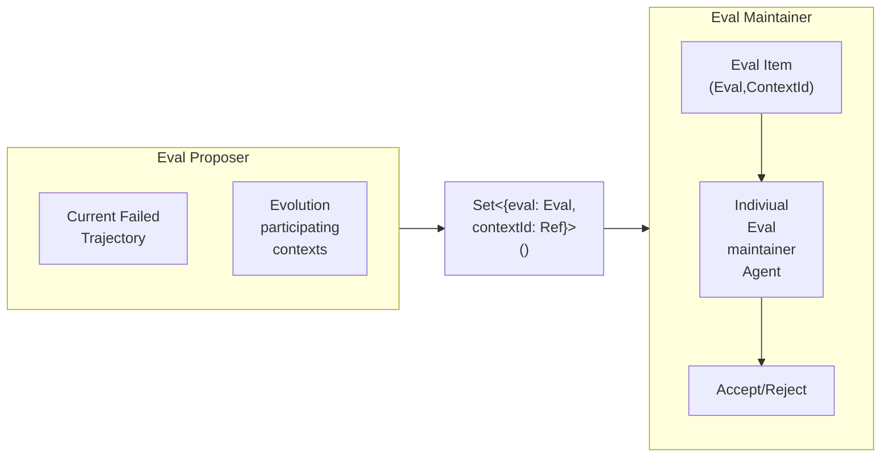
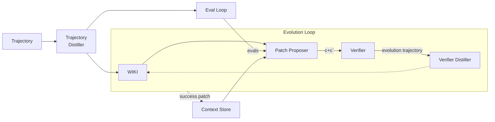

# Architecture

For a evoution to happen we need the following info as input
- The raw trajectory
- Explicit list of context which can participate in the evolution

During the evolution we get the below items as output
- For every failure trajctory we get set of evals to perform on some of the participating context. i.e  `Set<{eval: Eval, contextId: Ref}>()`
- After the evals are set, the evolution loop proposes patches for those contexts with accordance to a verifier.


## Detailed descriptions

### Evals
- Evals are also persisted after a failure trajectory. 
- The eval creator takes into account of the previously available evals. If this is already covered then it doesn't create more evals.
- For a newer test instance, it defines the eval and the required environment.

We mainly need 2(Agentic) + 1 (Orchestrator) components.



### Evolve
- Evolution happens only the participating `Contexts`.
- This loop proposes new patch to the context & with validation gate it either accepts or rejects the patch and moves ahead.
- The patch is created with the historical trajectory information including previous evolution loop trajectory, and the newer evals.
- The validation happens on top of all the evals, i.e new & old.


- Distillers create more structured output from the trajectory.
- Wiki maintains patterns, lessons, any naural language structure to help proposer better. It maintains a persistent histrory across multiple flow.


## LLD

Each LLM node is an coding agent. So they shuld be allowed to work with files and use bash, find, read i.e the normal coding tools.

### Trajectory
Trajectory is one of the input for the eval and evolution loop. Our aim is to solve for multi-agent system. So a linear trajectory that we typically maintain for chat completion is not the right approach.

In the current approach I'm not finding a proper way to handle compaction in the trajectory. So we will not consider it. A trajectory would represent the complete flow with any compaction or flow break.

The trajectory should also talk about any intermediary non-LLM step as well, though they might or might not participate in context evolution.

#### Solved
- A linear multi agent system where each setup would represent an agent, human or code.
#### Pending
- Parallel agents

#### structure
```markdown
> trajectory/
    - flow.md // Description of the flow
    - definition.json
    - traces.json
```
- flow.md
  A detailed description about the flow in natural language. It should describe flow the flow flows bewtween the agents, the goal, and what is expected out of the flow.
- definition.json
``` json
    [
        {
            "id": "",
            "type": "llm", // llm, user, code, tool,
            "systemPrompt": "",
            "description": "",
            "tools": [{}] // ToolDescription[];
        },
        {
            "id": "",
            "type": "user",
        },
        {
            "id": "",
            "type": "tool",
            "description": "",
            "params": "",
        },
        {
            "id": "",
            "type": "code",
            "description": "",
        }
    ]
```

- traces.json would be structured like below.
``` json
[
    {
        "itemRef": "research_agent", // llm type
        "overridenTool": {}, // tools override for this message,
        "mesage": {}, // OpenAIChatCompletion styled message
    },
    {
        "itemRef": "human_1", // user type
        "message": "text"
    },
    {
        "itemRef": "is_valid_output", // any code component reference,
        "output": {} // the type depend upon the component retrun type
    }
]
```

### Trajectory Distiller
A trajectory distiller provides a distilled view of out the long trajectory. It's an LLM node in this evolution loop.

Responsibility includes
- Finding failure patterns (including user feedback). e.g wrong tool invocaton, tool error, wrong context or ambigious context or missing context e.t.c
- miscellaneous improvement
- any patterns worth noting

#### output structure
```markdown
distilled-trajectory/
    - index.md // A overview of the entire distilled trajectory.
    - failures_and_patterns/
        - a_failure_or_pattern.md // a failure/pattern and all it's detail, like where it has originated, why it happened e.t.c
```

### Evals
Evals are the unit to evaluate. This help non-deterministic LLM scoring and provide insight on improving them. Mostly evals will be updated or appended from a failure trajectory.
- In this v1 solution, will explore whether `autoevals` can be use for representation of the evals as it provides a complete set of different eval types and evalution framework.

### Eval Proposer
- An LLM agent that takes the distilled trajectory & the contexts and produces a set of `{context, [eval]}`.
- 
### Eval Mainainer

### Wiki (data)
```
wiki/
  index.md
  patterns/     // patterns is for finding any patern which is useful for proposer to come up with a patch
    pattern-a.md
    pattern-b.md
    pattern-c.md
  impacts/          // Impacts maintains around what patches we have tried why they worked or why they didn't    
    impact_a.md
```

### Wiki Maintainer Agent
Wiki is the data, where as Wiki Maintainer agent data is an LLM agent whoch maintains the data. (very obvious, but it's for LLM).

- The maintainer agent find patterns from the distilled trajectory and appends or updates the wiki store.
- Everytime a update happens, it also maintains the index to keep everyting up-to-date. Index provides an entry which helps LLM bring more context from specific items.

### Patch Proposer
- This is an LLM agent that takes the Wiki & the context store to produce a set of `{contxt, patch}`.
  
### Verifier
- Driven by `autoevals` for the v1.
- Takes the modified contexts and tries to do the evalution with the existing evals including the newer ones.
- Verifier decides, wther a patch is acceptable or not. 

### Verifier Distiller
- It's another distiller which takes the verifier trajectory. It produces same output as trajectory distiller, but the prompt is different.

## Pending Decisions
- What if a generated eval is wrong? How to identify and fix it? 
  One of the solution can be to use the human gate, so without approval it won't be added.
- 